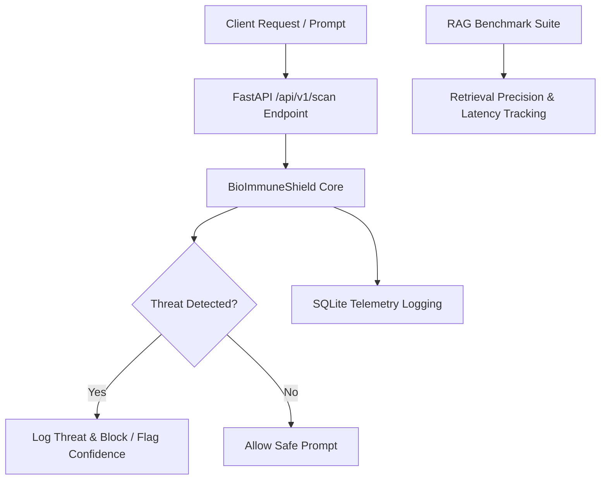

# AI-Sentinel: Security & RAG Evaluation Monorepo

ai-sentinel is a modular security and evaluation framework built for LLM applications. It centralizes threat mitigation, homoglyph normalization, zero-width injection sanitization, and RAG performance benchmarking under a single core package.

## Architecture Overview



## Package Structure

- **`packages/sentinel-core`**: Core security engine (`BioImmuneShield`), SQLite telemetry persistence, and RAG benchmarking suites.
- **`packages/prompt-shield`**: Specialized prompt injection defense wrappers.
- **`packages/rag-bench`**: Retrieval-augmented generation performance tracking.
- **`packages/sentinel-ui`**: Streamlit dashboard for real-time prompt testing.

## Quick Start & Testing

```bash
pip install -e packages/sentinel-core
python -m pytest packages/sentinel-core/tests/ -v
```

## CI/CD
Automated via GitHub Actions on every push to main.
